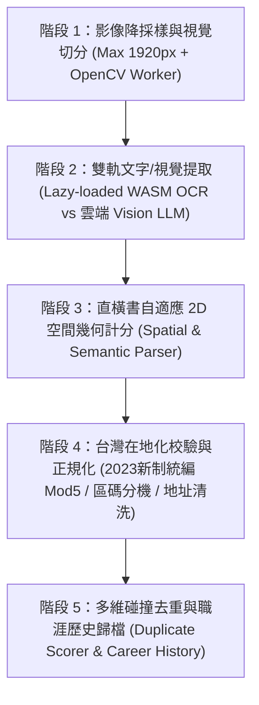

# Spec: YNHere — 跨平台智慧名片管理與交換系統規格書 (EGM Signed v2.1 Complete Edition)

> **版本**：2.1.0 (整合原版全功能全景 + EGM Goldfish 對抗式審查修訂 + 完整工程與部署藍圖)  
> **定位**：Local-First（本地優先）、零平台限制（iOS / Android / Windows / macOS / Linux 通用）、支援離線電腦視覺裁切與多模態 AI 辨識、具備開放標準導入/導出與點對點交換能力的現代化名片管理系統。

---

## 一、核心設計假設與跨平台解方 (Objective & Cross-Platform Strategy)

為了達成**「不綁定 iOS App、不限手機品牌（Android / iPhone 皆可）、電腦與平板也能無縫使用」**且**「支援離線與高隱私」**的目標，本系統採用 **Local-First PWA (Progressive Web App) + WebAssembly (WASM)** 架構：

1. **全平台零安裝即開即用**：
   - **手機端（iOS Safari / Android Chrome）**：打開網址即可調用相機（支援單張、連拍、1–8 張同框多拍、閃光燈補光、正反面連拍與相簿換圖重辨識），支援「加入主畫面（Add to Home Screen）」，具備獨立桌面圖示、全螢幕無網址列體驗與 100% 離線啟動能力。
   - **電腦端（Windows / macOS / Linux）**：大螢幕三欄式高效管理工作台，支援滑鼠拖放（Drag & Drop）批次匯入名片圖檔、Excel/CSV 報表與鍵盤快捷鍵操作。
2. **數據主權、持久化保護與 iOS ITP 防禦機制（Storage Persistence & Eviction Guard）**：
   - 結構化資料儲存於瀏覽器原生 **IndexedDB**（透過 Dexie.js 封裝）；高畫質名片正反面圖檔與 300px 列表縮圖分離儲存。
   - **持久化保護**：應用程式啟動時自動呼叫 `navigator.storage.persist()` 申請永久儲存權限，防止系統空間不足時被瀏覽器清除。
   - **iOS Safari 分頁與主畫面沙盒隔離防護**：偵測 `window.matchMedia('(display-mode: standalone)').matches`。若在 iOS Safari 一般分頁模式開啟（受 Apple 7 天 ITP 快取政策影響），頂部顯示提醒橫幅引導「先加入主畫面以獲得永久離線儲存，或一鍵匯出 `.ynpack` 遷移至主畫面 App」；當新增滿 5 張未備份名片時主動提示一鍵匯出備份。
   - **跨瀏覽器圖片壓縮降級**：優先使用 Canvas 轉碼 `image/webp (quality: 0.82)`；若偵測到部分 iOS Safari 回退為 PNG，自動降級為 `image/jpeg (quality: 0.82)`，確保單張名片圖體積控制在 $80\text{KB} \sim 200\text{KB}$。

---

## 二、系統核心功能與確定性演算法規格 (Core Features & Deterministic Algorithms)

### 1. 智慧名片掃描與五階段辨識管線 (5-Stage CV & OCR Pipeline)

- **三種取景/輸入模式**：
  1. **單張精準拍攝**：支援正反面連拍自動合併為同一聯絡人之正反兩面資訊。
  2. **連續快拍模式**：展會大量收名片時，連續按快門入列、背景非同步佇列辨識。
  3. **多張同框拍攝 / 電腦批次拖入（1–8 張）**：同畫面擺放 1–8 張名片（建議間距 2 公分），自動偵測多張矩形並獨立切分。
- **補拍與換圖機制**：詳情頁可隨時重拍或從相簿更換正面/反面圖，換圖後可選擇「僅更換圖片」或「重新執行辨識更新欄位」。



#### 階段 1：記憶體安全之電腦視覺切分（`src/services/cv/cardDetector.ts`）
- **記憶體安全保護（防 iOS WebContent 崩潰）**：
  - 任何相機拍攝或拖入之高解析度照片（如 12MP），在進入視覺分析前**強制先降採樣至長邊最大 `1920px`**。
  - 佇列控制（Sequential Queue）：多張連續快拍或批次拖入時，嚴格以單一佇列依序處理，且所有 OpenCV `cv.Mat` 實例必須包裹於 `try { ... } finally { mat.delete(); }` 中確保 0 Memory Leak。
- **多張切分、透視拉平（Deskew）與 Fallback 降級**：
  - 灰階化 $\rightarrow$ 高斯降噪 $\rightarrow$ 自適應邊緣檢測尋找閉合四邊形凸包，過濾條件：面積佔比 $3\% \sim 90\%$、長寬比 $\in [1.3, 2.0]$（或直式名片 $\in [0.5, 0.77]$），並執行 IoU $> 0.5$ 之非極大值抑制（NMS）與四頂點透視拉平轉正。
  - **Fallback 保證**：若桌面與名片顏色相近導致未偵測到合規四邊形，自動 Fallback 將整張輸入影像（或中央 90% 區域）作為單一名片送入下一階段，絕不報錯中斷。

#### 階段 2 & 3：雙軌辨識與空間幾何量化計分演算法（`src/services/ocr/ocrEngine.ts`）
- **引擎 A（預設本地免費離線引擎，手機與電腦皆內建）**：
  - 模型採用 **On-Demand Lazy Load + Cache API 快取**（首次開啟掃描時才下載快取 WASM 與繁中+英文模型包，之後 100% 離線免網路、0 元運作）。
  - 輸入為 OCR 行陣列 `OcrLine { text: string; bbox: [x0: number, y0: number, x1: number, y1: number] }`（其中 $w = x_1 - x_0$, $h = y_1 - y_0$）。
  - **直橫書自適應字級計算**：若單行 `h / w > 2.5` 且字元數 $\ge 2$，判定為**直書（Vertical）**，字級大小 $F = w$；否則判定為**橫書（Horizontal）**，字級大小 $F = h$。
  - **確定性欄位抽取順序**：
    1. **正則優先剝離**：先從所有行中抽取並標記 `Email`、`Website`、`Phone/Fax`、`統一編號（通過階段 4 統編驗證之 8 碼數字）` 與 `地址（含縣/市/區/鄉/鎮/路/街/段/巷/弄/號/樓之行）`。
    2. **剩餘文本行計分矩陣（Company / Name / JobTitle）**：
       - **公司得分 $Score_{\text{company}}$**：包含公司關鍵詞（`股份有限公司|有限公司|企業|科技|實業|國際|集團|工作室|事務所|銀行|醫院|診所|大學|協會|基金會|Co\.,?\s*Ltd|Inc\.|Corp\.|Corporation|Group|Studio|Enterprise`）得 $+60$ 分；字數 $\ge 6$ 得 $+15$ 分；位於名片上半部（$y_0 < 0.4 H$）得 $+10$ 分。最高分且 $> 0$ 者設為 `company`。
       - **職稱得分 $Score_{\text{title}}$**：包含職稱關鍵詞（`董事長|執行長|總經理|副總經理|副總|總監|協理|經理|副理|襄理|處長|部長|課長|組長|主任|店長|廠長|工程師|設計師|建築師|會計師|律師|醫師|顧問|專員|代表|特助|秘書|創辦人|合夥人|CEO|CTO|CFO|COO|CIO|VP|President|Director|Manager|Supervisor|Engineer|Designer|Architect|Consultant|Specialist|Coordinator|Founder|Partner`）得 $+60$ 分。
       - **姓名得分 $Score_{\text{name}}$**：去除空白後為 $2 \sim 4$ 個純中文字得 $+30$ 分；首字或前兩字匹配常見華人百家姓詞庫得 $+40$ 分；字級 $F$ 為剩餘候選行最大者得 $+25$ 分；若該行已匹配公司後綴則 $-100$ 分。若同一行同時含有姓名與職稱（如 `王大明 資深經理`），自動以空白或職稱詞邊界切分為 `name: "王大明"` 與 `jobTitle: "資深經理"`。
       - **英文姓名 `nameEn`**：匹配 `/^[A-Z][a-z]+(?:\s+[A-Z][a-z\-.]+){1,3}$/` 且不含公司或職稱關鍵字之獨立行。
       - **Fallback 防護**：若所有行皆未識別出姓名，`name` 自動填入 `"未命名聯絡人"`，確保 Zod 驗證與儲存 100% 成功。
- **引擎 B（選配雲端多模態視覺 AI 引擎）**：
  - 使用者可於設定填入 Gemini API Key（或 OpenAI Key），針對藝術字體、中英日三語混合、手寫筆記名片，直接以 `JSON Schema` 強制結構化提取所有欄位。

#### 階段 4：台灣在地化校驗與正規化規格（`src/services/ocr/twValidators.ts`）
1. **台灣統一編號 2023 新制驗證演算法 (`isValidTaiwanTaxId(taxId: string): boolean`)**：
   - 輸入必須符合 `/^\d{8}$/`。
   - 權重陣列 $W = [1, 2, 1, 2, 1, 2, 4, 1]$。
   - 對每個索引 $i \in [0, 7]$，計算乘積 $P_i = \text{Number}(taxId[i]) \times W[i]$，並計算十位數與個位數之和 $S_i = \lfloor P_i / 10 \rfloor + (P_i \bmod 10)$。
   - 設除第 7 碼（索引 $i = 6$）以外的總和為 $S_{\text{others}} = \sum_{i \neq 6} S_i$：
     - **一般情況（$taxId[6] \neq \text{'7'}$）**：總和 $Total = S_{\text{others}} + S_6$，若 **`Total % 5 === 0`** 則回傳 `true`（相容 2023/04 財政部模數 5 新制與舊制模數 10）。
     - **特殊邊界（$taxId[6] === \text{'7'}$，此時 $P_6 = 28 \rightarrow S_6 = 10$）**：第 7 碼權重和可取 `0` 或 `1`，只要 **`(S_others + 0) % 5 === 0 || (S_others + 1) % 5 === 0`** 任一成立即回傳 `true`。
2. **電話與分機正規化 (`normalizePhone(raw: string, typeHint?: string): PhoneItem`)**：
   - **分機提取**：匹配 `/(?:(?:#|ext\.?|分機|轉)\s*)(\d+)(?:[\/~-]\d+)?$/i`，提取第一組分機號碼 `ext`，並從主號碼字串移除分機部分。
   - **台灣手機**：移除非數字（保留開頭 `+`）後，若符合 `/^(?:\+?886|0)9(\d{2})(\d{3})(\d{3})$/`，正規化為 `number: "09$1-$2-$3"`、`normalizedDialString: "+886-9$1-$2-$3"`、強制標記 `type: 'mobile'`。
   - **台灣市話區碼切分**：定義台灣 3/4 碼特殊區碼表 `['0836', '037', '049', '082', '089']` 與 2 碼區碼表 `['02', '03', '04', '05', '06', '07', '08']`。若符合台灣市話，去除區碼開頭 `0`，正規化為 `+886-{area}-{local}[,{ext}]`（例如 `(02) 2345-6789 #101` $\rightarrow$ `+886-2-2345-6789,101`；`037-123456 ext 9` $\rightarrow$ `+886-37-123456,9`）。
   - **其他國際號碼**：若以 `+` 開頭且非 `+886`，清理空白與括號後保留原國碼並附加 `,${ext}`。
3. **地址清洗 (`cleanAddress(raw: string): string`)**：
   - 剝除前綴正則：`raw.replace(/^.*?(?:總公司|分公司|公司地址|台北公司|營業所|聯絡處|工廠地址|工廠|門市|地址|Address|ADD)[：:\s]+/i, '').trim()`。

---

### 2. 聯絡人管理、智慧去重與職涯異動履歷 (Contact & Career Management)
- **搜尋、排序與快篩膠囊**：
  - 全文即時搜尋：支援姓名、英文名、公司、職稱、統編、電話、Email、地址、自訂標籤與備註全文檢索。
  - 排序方式：建立日期（新到舊 / 舊到新）、公司名稱筆畫/字母、姓名排序。
  - 快篩膠囊：`待聯繫`、`回訪`、`已逾期`、`進行中`、`自訂標籤`。
- **雙軌群組與標籤（Groups & Tags）**：
  - **自動公司群組**：相同公司名稱（或相同統編）的名片自動歸入同一公司群組。
  - **自訂群組與標籤**：如「A 級客戶」、「展會夥伴」，支援批次勾選調整群組、批次貼標與**依日期區間預覽並批次刪除舊名片**。
- **多維碰撞去重演算法（`src/services/deduplication/duplicateMatcher.ts`）**：
  - **預處理與空值防呆**：所有空字串 `""` 不參與比對；姓名與公司去除空白與標點；Email 轉小寫；電話僅取 `type === 'mobile'` 的 `normalizedDialString` 進行個人比對。
  - **規則分數集合 $R$（取最大值 $\max(R)$）**：
    - **規則 1（統編 + 姓名）**：雙方 `taxId` 皆非空且相等 **且** 正規化中文姓名相等 $\rightarrow 0.95$。
    - **規則 2（Email 命中）**：雙方 `emails` 有任一相同小寫 Email **且**（雙方姓名相等 **或** 任一方姓名為 `"未命名聯絡人"`）$\rightarrow 0.90$。
    - **規則 3（個人手機命中）**：雙方有任一相同 `mobile` 號碼 **且**（雙方姓名相等 **或** 任一方姓名為 `"未命名聯絡人"`）$\rightarrow 0.88$。
    - **規則 4（同公司同名）**：雙方非空且非預設之姓名完全相等 **且** 雙方非空 `company` 之 Levenshtein 編輯距離 $\le 2$ $\rightarrow 0.85$。
    - **規則 5（跨公司跳槽/升遷偵測）**：雙方非空中文姓名完全相等 **且** `company` 不同，同時滿足（非空 `nameEn` 轉小寫相等 **或** 任一 Email 相等 **或** 任一手機號碼相等）$\rightarrow 0.82$。
  - 當最高分 $S \ge 0.80$ 時，觸發「建議合併同一人名片」。
- **無損職涯合併 (`mergeContacts(existing, incoming)`)**：
  - 當 `existing.company` 非空且 `(existing.company !== incoming.company || existing.jobTitle !== incoming.jobTitle)` 時，自動將舊公司、舊部門、舊職稱與舊名片正反面圖封裝為 `CareerSnapshot` 推入 `careerHistory[]`，再以新名片更新主欄位，完整保存人脈升遷與跳槽歷史。
  - `phones`, `emails`, `websites`, `addresses`, `tags`, `timelineNotes` 取無重複聯集（Set Union）。

---

### 3. 商務追蹤絲帶與跨平台行事曆連動 (Ribbon & CRM Follow-up)
- **狀態絲帶（Ribbon）**：支援設定待辦事項標題、到期日（Due Date）與狀態：`已逾期`（橘紅 `#F97316`）、`進行中`（翠綠 `#10B981`）、`待聯繫`（琥珀黃 `#F59E0B`）、`回訪`（商務藍 `#3B82F6`）、`已完成`（灰）。當系統時間超過 `dueDate` 且未完成時，自動標示為 `已逾期`。
- **互動時間軸備註（Timeline Notes）**：依時間軸記錄每次拜訪（`visit`）、通話（`call`）、信件（`email`）、會議（`meeting`）與一般筆記（`note`）。
- **跨平台行事曆 연동（`src/services/exchange/calendarIcs.ts`）**：
  - 一鍵將絲帶跟進事項匯出為標準 **`.ics` (iCalendar RFC 5545)** 檔案（含 `VALARM` 提前 30 分鐘提醒），或產生 **Google Calendar / Outlook Web Deep Link**，在手機與電腦行事曆產生原生系統通知。

---

### 4. 個人數位名片 (Digital Business Card)
- **三種高質感響應式版型**：
  1. `商務經典 (Classic Business)`：純白卡片 + 森林綠飾條，凸顯公司、職稱與統編。
  2. `現代極簡 (Modern Minimal)`：極簡幾何排版 + 醒目 QR Code。
  3. `暗黑質感 (Dark Executive)`：深曜石底色 + 翠綠/金字體，適合高階商務場合。
- **完整個人品牌欄位**：大頭照/Logo、中英文姓名、公司、部門、職稱、統編、多組電話、Email、地址、網站、社群連結（LINE、WeChat、LinkedIn、WhatsApp、Telegram）。
- **智慧時段問候語產生器**：分享數位名片時，依當下時間自動生成得體問候文案（早安 $05:00\sim11:59$ / 午安 $12:00\sim17:59$ / 晚安 $18:00\sim04:59$ / 展會初次見面模式），支援一鍵複製連同デジタル名片發送。

---

### 5. 離線優先之視覺化人脈地圖 (Privacy-First Offline Map)
- **零網路、零隱私外洩之台灣 368 鄉鎮市區離線定位（`src/services/map/twDistrictCoords.ts`）**：
  - 內建台灣全縣市與鄉鎮市區中心點經緯度離線字典。
  - 名片建立或匯入時，**直接在本地端毫秒級解析地址所屬縣市行政區並賦予座標**（不需外傳客戶地址至第三方伺服器，也徹底避免批次匯入 100 張名片時遭 OpenStreetMap API 封鎖 IP）。
  - 地圖模式採用 `Leaflet` 顯示绿色名片圖釘，點擊圖釘可預覽名片縮圖、快速撥號，或一鍵喚起 Google Maps / Apple Maps 規劃多點拜訪路線。
  - 使用者點擊單張名片的「精確門牌定位」時，才佇列呼叫 Nominatim API（嚴格限流 $\ge 1.1\text{s}$/req）。

---

### 6. 全方位導入、導出、交換與分享系統（支援單張、多張勾選、一鍵全選）

介面支援三種選取粒度：**「單張直接操作」、「多張自由勾選（Multi-Select）」、「一鍵全選（含篩選結果全選）」**，並針對不同傳輸通道實施物理容量保護（Hard Caps）：

| 維度 | 支援格式 / 協議 | 技術規格與單張 / 多張 / 全選行為 |
|---|---|---|
| **導出 (Export)** | **1. 標準 vCard (`.vcf`)** | **預設輸出 `VERSION:3.0`（相容 iOS / Android / macOS / Outlook 最高標準）**，匯入解析同時相容 `2.1 / 3.0 / 4.0` 與 `QUOTED-PRINTABLE`。單張、多選或全選時合併為單一 `.vcf` 檔案；定義自訂擴充屬性 `X-YNHERE-TAXID`、`X-YNHERE-NAME-EN`、`X-YNHERE-RIBBON`、`X-YNHERE-CAREER-JSON`，確保 YNHere 雙向轉換 100% 無損。 |
| | **2. YNHere 完整封裝 (`.ynpack`)** | 標準 `.zip` 壓縮封裝（使用 `fflate`），內含 `manifest.json`（含版本與筆數）、`contacts.json`（`ContactCard[]`）與 `images/{imageId}.webp`。支援單張、多選、全選匯出。 |
| | **3. Excel / CSV 報表 (`.csv` / `.xlsx`)** | 預設加上 `\uFEFF` (UTF-8 BOM)，標準欄位標頭：`姓名,英文姓名,公司,部門,職稱,統一編號,手機,公司電話,傳真,Email,網站,地址,標籤,追蹤狀態,待辦事項,備註`。支援單張、多選、全選。 |
| **導入 (Import)** | **1. `.ynpack` / `.zip` 備份還原** | 載入後顯示預覽清單，使用者可選擇「**全部匯入**」或「**單張勾選部分匯入**」，並自動執行 `calculateDuplicateScore` 去重或合併。 |
| | **2. 標準 vCard (`.vcf`) 批次匯入** | 支援單筆或多筆 `BEGIN:VCARD ... END:VCARD` 批次解析匯入。 |
| | **3. CamCard / 通用 CSV 匯入** | 自動映射中英文常見標頭（如 CamCard 之 `Name/姓名`, `Company/公司`, `Title/職稱`, `Mobile/手機`, `Tel/電話`, `Email/電子郵件`, `Address/地址`）。 |
| | **4. 圖檔批次拖放 (Drag & Drop)** | 支援將手機相簿多選照片或電腦掃描器圖檔一次拖入自動切分辨識。 |
| **交換與分享 (Share)** | **1. 原生免安裝 QR Code** | **僅限單張名片**：生成精簡版 vCard 3.0 QR Code（剔除長備註與歷史紀錄，強制控制 UTF-8 Payload $\le 700\text{ Bytes}$），確保對方免裝 App、用 iPhone / Android 原生相機一掃即存。 |
| | **2. 零後端加密連結 (`#card=...`)** | 使用 `fflate.zlibSync` + `Base64URL` 編碼純文字欄位（剔除圖片以防破版），**硬性上限為 1～10 張名片（且總長 $\le 4,000$ 字元）**。當勾選超過 10 張或全選時，UI 自動引導改用 `.vcf` 或 `.ynpack` 透過系統分享傳送。接收方點開連結可預覽並選擇「單張收錄」或「全部收錄」。 |
| | **3. WebRTC 點對點配對碼互傳** | 使用免自建後端之 `PeerJS` 公開信令（Peer ID 格式 `ynhere-pair-{6碼}`）+ STUN 建立 DataChannel，支援傳送單張、多選或全選之 `.ynpack` 二進位串流；若區網環境阻擋 P2P（8 秒逾時），自動平滑降級為檔案分享。 |
| | **4. 系統原生分享 (`Web Share API`)** | 呼叫 `navigator.share({ files })` 直接將單張或多張 `.vcf` / `.ynpack` 丟進 LINE、Teams、WhatsApp、AirDrop。 |

---

## 三、技術堆疊與架構選型 (Tech Stack)

| 層級 | 選用技術與版本 | 選型理由 |
|---|---|---|
| **核心框架** | **React 19 + TypeScript 5.8 + Vite 6** | 嚴格型別安全、極速建置、手機與桌面瀏覽器全面支援。 |
| **PWA 與離線引擎** | **vite-plugin-pwa (Workbox)** | 支援安裝至手機與電腦桌面、100% 離線開啟；大型 WASM 採 On-Demand Runtime Cache。 |
| **UI 與設計系統** | **Tailwind CSS v4 + Lucide React** | 實踐「無壓力森林薄荷綠」圓角卡片美學，支援手機底部導覽列与電腦三欄式響應式佈局。 |
| **本地資料庫** | **Dexie.js 4 (IndexedDB Wrapper)** | 支援複合索引、交易安全性、圖片 Blob 分離存儲與高速檢索。 |
| **電腦視覺與 OCR** | **Canvas 2D / OpenCV (選擇性增強) + Tesseract.js v5 + Gemini API** | 本地端完成影像降採樣、矩形切分、離線 OCR 與空間幾何解析；選配支援 Gemini Vision JSON Schema 解析。 |
| **交換與打包** | **fflate (極速 ZIP/Zlib) + qrcode.react** | 毫秒級打包/解壓 `.ynpack`、壓縮 `#card=` URL Hash、生成高相容 vCard QR Code。 |
| **地圖引擎** | **Leaflet + OpenStreetMap + 台灣 368 行政區離線座標字典** | 免綁定商業信用卡金鑰，支援離線行政區定位與圖釘預覽導航。 |
| **驗證與測試** | **Zod + Vitest + Testing Library** | 所有匯入/OCR 輸出皆經過 Zod Schema 嚴格驗證；TDD 單元測試覆蓋所有核心演算法與編解碼器。 |

---

## 四、標準指令集 (Commands)

```bash
# 安裝相依套件
npm install

# 啟動本地開發伺服器 (支援區網手機連線測試)
npm run dev -- --host

# 執行 TypeScript 嚴格型別檢查與語法檢查
npm run typecheck

# 執行 TDD 單元與整合測試 (單次執行並驗證全數通過)
npm run test -- --run

# 建置生產環境跨平台 PWA 靜態包
npm run build

# 預覽生產環境建置結果
npm run preview
```

---

## 五、專案目錄結構 (Project Structure)

```text
YNHere/
├── docs/
│   └── designs/
│       └── YNHere_Spec.md              # 系統規格書 (本文件)
├── tasks/
│   ├── plan.md                         # 階段性技術實作計畫
│   └── todo.md                         # 原子化可驗證任務清單
├── public/
│   ├── manifest.json                   # PWA 安裝描述檔
│   └── icons/                          # 跨平台桌面與手機圖示
├── src/
│   ├── types/
│   │   └── contact.ts                  # Zod Schema 與 TypeScript 核心型別定義
│   ├── db/
│   │   ├── database.ts                 # Dexie IndexedDB 資料庫與圖片 Blob 表定義
│   │   └── storageGuard.ts             # navigator.storage.persist() 與 iOS 分頁偵測
│   ├── services/
│   │   ├── cv/
│   │   │   └── cardDetector.ts         # 影像 1920px 降採樣、多張矩形切分、透視拉平與 WebP/JPEG 壓縮
│   │   ├── ocr/
│   │   │   ├── twValidators.ts         # 台灣統編 2023 新制 Mod5 驗證、區碼分機正規化、地址清洗
│   │   │   ├── spatialParser.ts        # 直橫書自適應 2D 空間幾何計分與欄位分類大腦
│   │   │   ├── ocrEngine.ts            # 本地 Tesseract WASM 佇列與選配 Gemini Vision AI 引擎
│   │   ├── deduplication/
│   │   │   └── duplicateMatcher.ts     # 多維度名片碰撞計分與職涯歷史無損合併器
│   │   ├── map/
│   │   │   └── twDistrictCoords.ts     # 台灣 368 鄉鎮市區離線經緯度解析與 Nominatim 限流佇列
│   │   └── exchange/
│   │       ├── vcardCodec.ts           # vCard 3.0/4.0 (.vcf) 單張/多張/全選雙向無損編解碼器
│   │       ├── ynpackArchive.ts        # .ynpack (ZIP) 完整圖文封裝匯出/匯入
│   │       ├── tabularCodec.ts         # CSV (UTF-8 BOM) / CamCard 欄位映射匯入與匯出
│   │       ├── calendarIcs.ts          # 絲帶待辦轉 .ics 行事曆與 Google/Outlook Deep Link
│   │       └── urlShareCodec.ts        # 零後端 URL Hash (#card=) 壓縮編解碼與上限保護
│   ├── components/
│   │   ├── layout/                     # 響應式導覽列與 iOS 持久化提醒橫幅
│   │   ├── scanner/                    # 相機取景器 (單張/連拍/多張)、拖放上傳區、切分預覽與引擎切換
│   │   ├── contacts/                   # 聯絡人列表 (單選/多選/全選)、詳情抽屜、職涯履歷、合併精靈
│   │   ├── ribbon/                     # 商務追蹤絲帶與時間軸備註元件
│   │   ├── map/                        # 視覺化人脈地圖與路線導航
│   │   ├── mycard/                     # 個人數位名片編輯器、3種版型、智慧問候語與 QR Code 模態框
│   │   └── exchange/                   # 導入/導出中心與 WebRTC 配對碼互傳面板
│   ├── App.tsx
│   └── main.tsx
├── tests/
│   ├── twValidators.test.ts            # 統編新舊制、電話區碼分機與地址清洗 TDD 測試
│   ├── spatialParser.test.ts           # 橫書与直書 2D 空間幾何欄位分類 TDD 測試
│   ├── duplicateMatcher.test.ts        # 碰撞計分與職涯履歷合併 TDD 測試
│   └── exchangeCodecs.test.ts          # vCard、.ynpack、CSV、URL Hash 與 .ics 雙向無損 TDD 測試
├── package.json
├── tsconfig.json
└── vite.config.ts
```

---

## 六、資料模型與 Zod 嚴格驗證規範 (`src/types/contact.ts`)

```typescript
import { z } from 'zod';
import { isValidTaiwanTaxId } from '../services/ocr/twValidators';

export const PhoneItemSchema = z.object({
  type: z.enum(['mobile', 'work', 'fax', 'other']),
  number: z.string().min(1),
  extension: z.string().optional(),
  normalizedDialString: z.string().min(1),
});

export const CareerSnapshotSchema = z.object({
  id: z.string().uuid(),
  company: z.string(),
  department: z.string().default(''),
  jobTitle: z.string().default(''),
  frontImageId: z.string().optional(),
  backImageId: z.string().optional(),
  archivedAt: z.string().datetime(),
});

export const RibbonTaskSchema = z.object({
  status: z.enum(['none', 'pending', 'in_progress', 'follow_up', 'overdue', 'completed']),
  taskTitle: z.string().default(''),
  dueDate: z.string().datetime().optional(),
});

export const TimelineNoteSchema = z.object({
  id: z.string().uuid(),
  content: z.string().min(1),
  createdAt: z.string().datetime(),
  category: z.enum(['visit', 'call', 'email', 'meeting', 'note']).default('note'),
});

export const ContactCardSchema = z.object({
  id: z.string().uuid(),
  createdAt: z.string().datetime(),
  updatedAt: z.string().datetime(),

  frontImageId: z.string().optional(),
  backImageId: z.string().optional(),
  thumbnailDataUrl: z.string().optional(),

  name: z.string().min(1).default('未命名聯絡人'),
  nameEn: z.string().default(''),
  company: z.string().default(''),
  department: z.string().default(''),
  jobTitle: z.string().default(''),
  taxId: z.string().default('').refine(
    (val) => val === '' || isValidTaiwanTaxId(val),
    { message: '統一編號不符合財政部 8 碼檢核邏輯' }
  ),

  phones: z.array(PhoneItemSchema).default([]),
  emails: z.array(z.string().email()).default([]),
  websites: z.array(z.string()).default([]),
  addresses: z.array(z.string()).default([]),
  socialLinks: z.record(z.string(), z.string()).default({}),

  location: z.object({
    lat: z.number(),
    lng: z.number(),
    isApproximateDistrict: z.boolean().default(true),
  }).optional(),

  groupId: z.string().optional(),
  tags: z.array(z.string()).default([]),
  ribbon: RibbonTaskSchema.default({ status: 'none', taskTitle: '' }),
  timelineNotes: z.array(TimelineNoteSchema).default([]),
  careerHistory: z.array(CareerSnapshotSchema).default([]),
  isMyDigitalCard: z.boolean().default(false),
});

export type ContactCard = z.infer<typeof ContactCardSchema>;
export type PhoneItem = z.infer<typeof PhoneItemSchema>;
export type CareerSnapshot = z.infer<typeof CareerSnapshotSchema>;
export type RibbonTask = z.infer<typeof RibbonTaskSchema>;
export type TimelineNote = z.infer<typeof TimelineNoteSchema>;
```

---

## 七、跨平台響應式介面與視覺規範 (Responsive UI & Design System)

### 1. 響應式導覽架構
- **手機端（Portrait）**：底部懸浮導覽列 `[聯絡人] [人脈地圖] [📷 中央突出掃描鈕] [我的名片] [交換/備份]`。
- **電腦/平板端（Landscape）**：左側固定導覽欄 + 中央搜尋/快篩/批次勾選卡片牆 + 右側滑出式詳情與時間軸面板（Master-Detail 雙欄/三欄視圖）。

### 2. 視覺美學與狀態色彩
- **森林薄荷綠無壓力主題**：主色 `#10B981` (Emerald 500)、深綠標題 `#064E3B`、柔和背景 `#F8FAFC` 與純白圓角卡片。
- **絲帶語意色**：`已逾期`（橘 `#F97316`）、`進行中`（綠 `#10B981`）、`待聯繫`（黃 `#F59E0B`）、`回訪`（藍 `#3B82F6`）。

---

## 八、測試策略與開發邊界 (Testing Strategy & Boundaries)

### TDD 測試矩陣 (TDD Verification Matrix)
實作階段嚴格遵循 **RED (先寫失敗測試) $\rightarrow$ GREEN (最小實作通過) $\rightarrow$ REFACTOR (重構)**：
1. `tests/twValidators.test.ts`：驗證統編新舊制與第 7 碼為 `7` 邊界條件、2/3 碼區碼與分機撥號格式轉換、地址清洗。
2. `tests/spatialParser.test.ts`：驗證橫書與直書 OCR 座標框之姓名、公司、職稱量化計分與切分。
3. `tests/duplicateMatcher.test.ts`：驗證空值防呆、碰撞分數計算、跨公司跳槽職涯快照 (`careerHistory`) 無損歸檔。
4. `tests/exchangeCodecs.test.ts`：驗證單張、多張勾選、全選之 vCard 3.0 (`.vcf`)、`.ynpack` (ZIP)、CSV (UTF-8 BOM)、`.ics` 行事曆與 URL Hash (`#card=`) 雙向無損編解碼。

### 開發邊界 (Boundaries)
- **Always do（必須執行）**：
  - 寫任何業務邏輯前先寫單元測試並驗證紅燈轉綠燈。
  - 所有外部匯入與 OCR 輸出經過清洗與 Fallback 後，必須通過 `Zod` 驗證。
  - 匯出 CSV 時必須包含 `\uFEFF` (UTF-8 BOM) 標頭。
- **Ask first（需先確認）**：
  - 引入需要付費金鑰或外部私有後端的服務。
  - 變更 `.ynpack` 封裝結構或資料庫主鍵規則。
- **Never do（嚴格禁止）**：
  - 禁止硬編碼（Hardcode）任何 API Key。
  - 禁止在未經使用者主動點擊下將名片資料外傳至第三方伺服器。
  - 禁止在合併名片時直接覆蓋刪除舊公司與舊職稱紀錄（必須移入 `careerHistory`）。

---

## 九、部署架設與同事多人使用指南 (Deployment & Multi-User Guide)

1. **0 元免維護架設**：將 `npm run build` 產出之 `dist/` 靜態資料夾部署於 **Cloudflare Pages / Vercel / GitHub Pages**（免費提供全球 CDN 與相機必備之 HTTPS 憑證），或放入公司內部 **Synology/QNAP NAS (Docker Nginx)**。
2. **同事跨裝置使用與天然隱私隔離**：同事透過 iPhone、Android 或 Windows/Mac 打開同一個網址並點選「加入主畫面 / 安裝應用程式」。因資料庫位於各自裝置之瀏覽器沙盒（IndexedDB），多人共用同一網址時**各自名片 100% 獨立隔離不混雜**。
3. **同事間名片交換與分發**：支援勾選「單張」、「多張」或「全選」後，透過 QR Code、加密連結、WebRTC 配對碼或匯出 `.ynpack` / `.vcf` 至公司群組一鍵匯入。
