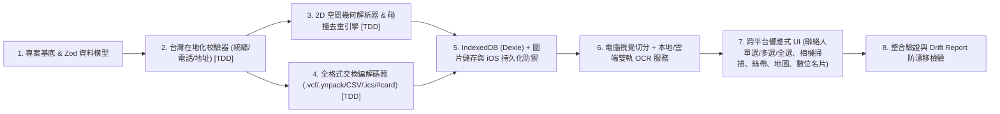

# YNHere 技術實作計畫 (Implementation Plan)

> 對應規格書：[docs/designs/YNHere_Spec.md](file:///c:/Users/user/.gemini/YNHere/docs/designs/YNHere_Spec.md) (v2.1 Complete Edition)

## 1. 元件相依性與建置順序 (Component Dependency Graph)

## 2. 風險與緩解策略 (Risks & Mitigations)
1. **iOS Safari 7 天快取清除與主畫面沙盒隔離**：啟動時執行 `navigator.storage.persist()`，並偵測非 `standalone` 模式主動提示加入主畫面與備份。
2. **高解析度相片導致行動端記憶體溢位**：CV 與 OCR 前置強制降採樣至長邊 `1920px`，並以佇列依序處理。
3. **分享連結長度與 QR Code 密度超載**：vCard QR Code 強制精簡至 $\le 700\text{ Bytes}$；URL Hash (`#card=`) 強制上限 10 張，超過時自動引導改用 `.vcf` 或 `.ynpack` 檔案分享。

## 3. 階段檢核點 (Verification Checkpoints)
- **Checkpoint 1 (Core Logic TDD)**：`npm run test -- --run` 通過所有統編、電話、空間幾何、去重與交換格式雙向無損單元測試。
- **Checkpoint 2 (Build & Type Safety)**：`npm run typecheck` 與 `npm run build` 零錯誤通過，產出完整 PWA 靜態包。
